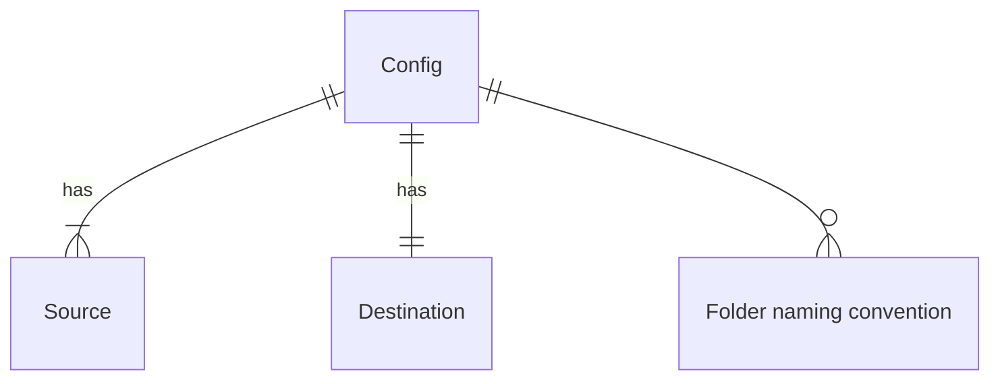
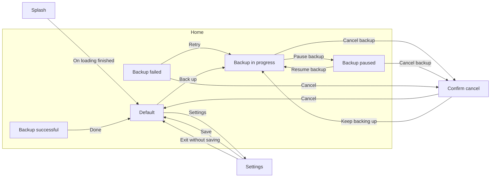

> Generated by modelwright from erd.json, flows.json and config.json — don’t edit; it’s overwritten on every save.

# photobackup

## Data model

### Entities

#### Config

No attributes.

#### Source

Where we're backing photos up from

| Attribute | Note |
| --- | --- |
| Type | Type can be `local` or `remote` |
| Name |  |
| Location | URL or local path |
| Credentials | Optional – e.g Google auth token |

#### Destination

Where photos are being backed up to. This is always AWS

| Attribute | Note |
| --- | --- |
| Name |  |
| Location | AWS URL |
| Credentials | AWS auth token |
| AWS storage class |  |

#### Folder naming convention

How the backup zip file is named

| Attribute | Note |
| --- | --- |
| Pattern | eg.arnautovic-photos-2026-09-vedran |

### Relationships

- Each Config has one or more Sources. Each Source belongs to exactly one Config.
- Each Config has exactly one Destination. Each Destination belongs to exactly one Config.
- Each Config has zero or more Folder naming conventions. Each Folder naming convention belongs to exactly one Config.

## Screens and flows

### Splash

Transition from the splash screen to the home screen as soon as the app has loaded

Information:

- Loading indicator
- Credits

Actions:

- **On loading finished** → Home › Default

### Home

When selecting items to back up, the user can select one or more of Google Drive and Local folder.

#### Default (default)

Items to back up are local folder and google drive location. The values of these are prepopulated from settings. The user can just select whether they want them backed up. They can only be changed in settings.If 'Clean up after backup" is selected, the backed up files from the local folder and google drive are deleted

Information:

- Nothing yet

Actions:

- **Settings** → Settings
- **Select items to back up** (dead end)
- **Back up** (primary) → Home › Backup in progress
- **Clean up after backup** (dead end)
- **Set backup month** (dead end)

#### Backup in progress

The progress indicator will show the stage (eg. downloading from google drive, compressing, uploading, cleaning up) and % completed of each stage

Information:

- Progress indicator

Actions:

- **Cancel backup** → Confirm cancel
- **Pause backup** → Home › Backup paused

#### Backup successful

Information:

- Confirmation of number of items and size backed up

Actions:

- **Done** → Home › Default

#### Backup failed

Information:

- Error details

Actions:

- **Retry** (primary) → Home › Backup in progress
- **Cancel** → Confirm cancel

#### Backup paused

Information:

- Backup paused
- Stage and % completed

Actions:

- **Resume backup** (primary) → Home › Backup in progress
- **Cancel backup** → Confirm cancel

### Settings

Settings should be presented as a modal

Information:

- Google drive credentials
- AWS credentials
- Default Google drive location
- Default AWS location
- Default local folder
- Folder naming convention
- AWS storage class

Actions:

- **Save** (primary) → Home › Default
- **Exit without saving** → Home › Default

### Confirm cancel

This is a modal presented on top of home page

Information:

- Cancel backup?

Actions:

- **Cancel** → Home › Default
- **Keep backing up** → Home › Backup in progress

## Preview

- URL: http://localhost:5173
- Dev command: `npm run dev:web`
